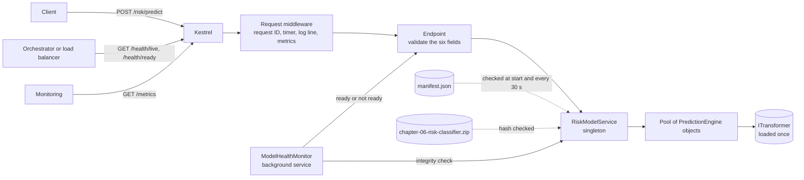
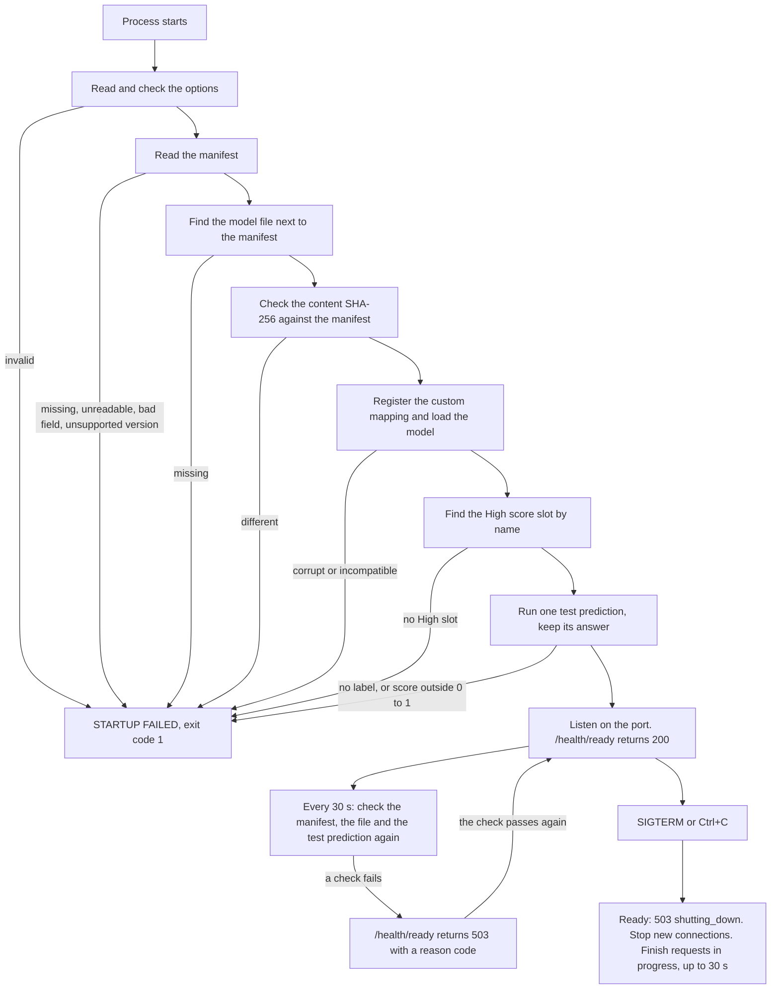

# DMLS Chapter 7 — Deployment

## Research question

> Can the frozen Chapter 6 risk classifier run as an inference service that gives the same answers as the Chapter 6 pipeline, stays fast under concurrent load, and fails in a way that an operator can see and understand?

The service takes the six raw transaction fields, runs the Chapter 6 model, and applies the Chapter 6 threshold. It does not train or change the model.

All numbers in this document come from `evaluations/risk-classification/chapter-07-results.json` and from the raw files in `evaluations/risk-inference/`.

## Result in one table

| Question | Answer |
|---|---|
| Does the service match Chapter 6? | Yes. 2,000 fixed samples, 194,000 responses, 0 mismatches, largest score difference 0. The Windows API and the Linux container give identical answers. |
| Which inference design? | **Pooled** `PredictionEngine` objects. A new engine for every request allocates about 335 KB and gave 650 to 930 requests per second at any concurrency. |
| How much faster is pooling? | 26 times at 10 clients and 41 times at 50 clients (average of two repeat runs: 755 against 19,809, and 744 against 30,506 requests per second). |
| Is it safe to start and stop? | A bad model or manifest stops the start-up (exit code 1). A model that breaks at run time makes `/health/ready` return 503. A stop lets the requests in progress finish. |
| What does observability cost? | The per-request log line costs 23 to 30% of throughput. The metrics and the middleware cost 3 to 7%. |
| Tests | 140 automated tests pass. |

## 1. Deployment architecture



- **One process, one model.** The model loads once and all requests share the `ITransformer`. A `PredictionEngine` is not thread-safe, so no two requests use one at the same time.
- **The model sits next to its manifest.** In the Docker image both are in `/app/Models`. The service finds them from its content root, so no path depends on the host.
- **The endpoint stays thin.** Feature engineering is part of the saved model pipeline (`EngineeredFeatures`). The service never recomputes it.

| Project | Role |
|---|---|
| `src/RiskInference.Api` | The service and its `Dockerfile`. |
| `src/RiskClassificationLab` | Chapter 6 code. The API uses its input type, its custom feature mapping and its `FinalModelStore`. |
| `src/RiskInference.Benchmark` | Load tests (`inprocess`, `http`), the `verify` check against Chapter 6, and the `compare` tool. |
| `tests/RiskInference.Api.Tests` | 140 tests. |

## 2. Start-up lifecycle



The service does not listen until every check in the first part has passed. A service with a bad model never becomes ready. It also cannot hide the problem behind an HTTP 200, because it does not answer at all.

## 3. Model and version contract

The manifest is `Models/chapter-06-risk-classifier.manifest.json`:

```json
{
  "modelVersion": "chapter-06-v1",
  "modelFile": "chapter-06-risk-classifier.zip",
  "modelSha256": "0fd45f32162ab491340192b4023e1990a3d13935cd050f7b133745e8e309b571",
  "threshold": 0.1121373102068901,
  "featureSchemaVersion": "risk-features-v1",
  "decisionPolicyVersion": "risk-policy-v1"
}
```

- **Rejected at start:** a missing field, an unknown field, a `modelFile` that is a path, a hash that is not 64 hex characters, a threshold outside the range 0 to 1, and a feature-schema or decision-policy version that this build does not support. The error lists every problem.
- **Full-precision threshold.** The threshold is the Chapter 6 value. A rounded value of `0.1121` would move the decision boundary.
- **Hash rule.** The hash covers the zip entry names and their bytes, not the raw zip file. Saving the same model again (new timestamps) keeps the hash. A change in the content changes it.
- **No drift from Chapter 6.** A test compares the manifest with the frozen `chapter-06-risk-classifier.policy.json` (hash, threshold, file name, version).
- **Versions in every answer.** Each prediction carries `modelVersion`, `decisionPolicyVersion` and `threshold`. `/health/ready` also shows `featureSchemaVersion`.
- **Changing the model or the threshold is a new manifest and a new deployment.** The service never reloads a model while it runs.

### API

| Endpoint | Answer |
|---|---|
| `POST /risk/predict` | 200 prediction. 400 for an invalid or unreadable request. 503 if the integrity check failed. 500 for an unexpected error. |
| `GET /health/live` | 200 while the process runs. It never fails because of the model, because a restart does not repair a bad file. |
| `GET /health/ready` | 200 if the service can serve predictions. 503 with a reason code if not. |
| `GET /metrics` | Counts, rates and latency percentiles. No transaction data. |

Request fields: `amount` (above 0), `transactionHour` (whole number, 0 to 23), `customerTransactionCount24h`, `recentFailureCount`, `beneficiaryAgeDays` (whole numbers, 0 or more) and `isHighRiskCountry` (required). A missing field is an error, never a silent 0 or `false`.

Response fields: `predictedRisk`, `highRiskScore`, `flaggedHighRisk`, `modelVersion`, `threshold`, `decisionPolicyVersion`.

`predictedRisk` is the model's own Low, Medium or High. `flaggedHighRisk` is the business decision `score(High) >= threshold`. A transaction can be predicted Medium and still be flagged. In the 2,000 reference samples, 141 were flagged and 63 of those were predicted Low or Medium.

## 4. Inference design and the pooling decision

A `PredictionEngine` wraps the loaded model for single-record prediction. It is not thread-safe. Two designs were built behind one switch (`RiskModel:InferenceMode`):

| | `EnginePerRequest` | `Pooled` (default) |
|---|---|---|
| Each request | Creates an engine, predicts, disposes it | Rents an idle engine, predicts, returns it |
| Cost of one engine | about 0.5 ms and 335 KB | paid once per engine |
| After an exception | the engine is disposed | the engine is disposed and not returned |

Both designs give exactly the same predictions (tested on 200 records, under 64 threads, and on 1,000 records at run time).

### Results

Release build, 1,000 Chapter 6 records, 5 s warm-up, 60 s per level. Each client keeps one request in flight. There were 0 errors in every run.

| Clients | Design | Requests/s | p50 (ms) | p95 (ms) | p99 (ms) | Server CPU | Peak memory |
|---:|---|---:|---:|---:|---:|---:|---:|
| 1 | new engine | 670 | 1.40 | 2.00 | 4.39 | 8.4% | 117 MB |
| 1 | pooled | 7,120 | 0.13 | 0.20 | 0.33 | 9.1% | 85 MB |
| 10 | new engine | 927 | 10.13 | 17.77 | 23.28 | 63.8% | 150 MB |
| 10 | pooled | 26,363 | 0.35 | 0.57 | 1.18 | 34.8% | 80 MB |
| 50 | new engine | 691 | 68.47 | 111.07 | 130.66 | 59.6% | 212 MB |
| 50 | pooled | 36,091 | 1.07 | 2.82 | 7.03 | 33.5% | 84 MB |
| 100 | new engine | 650 | 149.32 | 206.90 | 263.03 | 52.5% | 195 MB |
| 100 | pooled | 35,776 | 1.66 | 7.17 | 30.35 | 28.6% | 88 MB |

**Repeat check.** The order was pooled, new, pooled, new, at 10 and 50 clients. The result held.

| Clients | New engine (two runs) | Pooled (two runs) | Speed-up of the averages |
|---:|---|---|---:|
| 10 | 790 and 720 | 17,835 and 21,783 | 26 times |
| 50 | 781 and 708 | 27,269 and 33,742 | 41 times |

**Why.** The in-process run shows the cause. Creating and disposing one engine took 497 µs on average and allocated 335,211 bytes. A prediction on an existing engine took 0.4 µs and allocated 108 bytes. At 900 requests per second the new-engine design allocated about 300 MB per second, so the garbage collector ran about once for every 5 requests, and the threads waited for it. Over HTTP, the server allocated about 340,000 bytes per request with a new engine and about 3,800 bytes pooled (measured with `dotnet-counters`).

**Decision: keep `Pooled`.** The new-engine mode stays available through the setting.

**What the numbers do not show.** The load generator shared the machine with the server, so the pooled throughput is a lower bound and not a capacity figure. The pooled throughput varied by about 20% between repeat runs.

## 5. Operational readiness

### Health

- **Live** answers "does the process work?". **Ready** answers "can the service safely serve predictions?".
- Ready is 503 when the manifest or the model file on disk is missing, changed or corrupted, or when the model gives a different answer for the fixed test input. It is also 503 while the host stops. The body holds only a reason code: `model_unavailable`, `model_hash_mismatch`, `model_invalid`, `manifest_unavailable`, `manifest_invalid`, `manifest_changed`, `test_prediction_changed`, `test_prediction_failed` or `shutting_down`. No path and no exception text.
- While not ready because of a failed check, `POST /risk/predict` also answers 503. It does not serve predictions from a model that failed its check.
- A host that is stopping is not ready, but it still answers requests that reach it. A load balancer needs time to notice. This avoids errors during the drain.
- The check repeats every 30 s (`RiskModel:IntegrityCheckIntervalSeconds`). The service becomes ready again when the check passes, with no restart.

### Structured logging

Each prediction request writes one JSON line:

```json
{"Timestamp":"2026-11-15T17:11:36.674Z","LogLevel":"Information","Message":"Request completed. Method POST Route /risk/predict Status 200 Outcome Predicted DurationMs 26.538 ModelVersion chapter-06-v1 PolicyVersion risk-policy-v1 RequestId demo-req-001 PredictedRisk High Flagged True","State":{"RequestId":"demo-req-001","ModelVersion":"chapter-06-v1","PolicyVersion":"risk-policy-v1","DurationMs":26.538,"Outcome":"Predicted","StatusCode":200,...}}
```

- **Request ID.** The service uses the `X-Request-ID` header of the caller if it is 1 to 64 safe characters. Else it makes one. The ID is in the response header, in error bodies and in every log line of the request.
- **Outcome** is one of `Predicted`, `ValidationFailed`, `MalformedRequest`, `NotReady`, `Error`.
- **Never logged:** transaction fields, customer data, scores, the query string. A test sends an amount of `98765.4321` and checks that no log line contains it.
- Health and metrics requests are written at Debug level only.

### Metrics (`GET /metrics`)

Request count by outcome, server error rate (500 and 503), client error rate (400), latency mean, p50, p95, p99 and max, predictions by risk level, flagged High count, and the High-risk flag rate. The latency percentiles come from log-spaced buckets and are at most 10% above the exact value (a test checks this on 20,000 values). The same data goes to a `System.Diagnostics.Metrics` meter named `RiskInference.Api`.

The prediction distribution and the flag rate are the inputs for Chapter 8.

### Sanitized errors

A client gets a fixed message and the request ID. The log gets the full exception, the request ID and the versions. A test throws an exception with a fake path and secret in its text, and checks that neither appears in the response.

### Shutdown

On SIGTERM or Ctrl+C the host stops new connections and waits for the requests in progress, up to `RiskModel:ShutdownTimeoutSeconds` (default 30).

### Cost of the observability

The same machine, alternating order, two rounds of 15 s per level:

| Variant | 10 clients (requests/s) | 50 clients (requests/s) |
|---|---:|---:|
| Step 6 code (before this step) | 23,250 and 23,346 | 33,901 and 34,657 |
| Step 7, per-request log on | 16,266 and 16,972 | 25,990 and 25,105 |
| Step 7, per-request log off | 21,948 and 22,597 | 32,577 and 32,224 |

The log line costs 23 to 30%. It goes to the console, one line each. At these rates that is visible. At lower rates it is not. Set `Logging:LogLevel:RiskInference.Api.Operations.RequestObservabilityMiddleware` to `Warning` to turn it off. Before I ran this A/B, single runs showed 4,000 to 7,000 requests per second. That was noise from builds and Docker running at the same time. A single run is not enough here.

## 6. Docker validation

Build from the repository root: `docker build -f src/RiskInference.Api/Dockerfile -t risk-inference:chapter-07 .`

| Item | Value |
|---|---|
| Image | `risk-inference:chapter-07`, `sha256:40fec27e6b74…`, 398,924,905 bytes |
| Base images | `dotnet/sdk:10.0` (build) and `dotnet/aspnet:10.0` (runtime, .NET 10.0.15, Ubuntu 24.04) |
| User | `app` (UID 1654), not root |
| Cold start to ready | 2,646, 2,254 and 2,280 ms. `docker restart`: 2,135 ms. |

| Check | Result |
|---|---|
| Build, start, model loads, hash check | Pass |
| `/health/live`, `/health/ready` | 200, 200 |
| Invalid request | 400, no exception text in the body |
| Six bad artifacts (not a zip, wrong hash, threshold 1.5, no model file, policy `v9`, no manifest) | Each exits with code 1 and never listens |
| Model file deleted while running | Ready 503 `model_unavailable`, live 200, predictions 503. After the file returns: ready 200. |
| Restart | 2,000 answers identical before and after |
| 32 concurrent workers, 194,000 responses | 0 mismatches |
| Stop with 50 clients sending | `docker stop` 1.38 s, exit code 0. After the stop began: 508 requests answered 200, 0 HTTP errors, 0 answers cut in the middle. The failures were 27 idle connections that the server closed, 405 new connections closed at once by Docker's port proxy, and 200 refused connections. |

**Consistency, Chapter 6 → local API → Docker API.** The 2,000 samples are every 5th record of `train-5000.csv` and all of `test-1000.csv`. The test records were only scored. The reference is the frozen model run with one batch `Transform`, with the High score read by slot name. Labels and threshold decisions match exactly. The largest score difference is 0 (the tolerance of the check is 1e-5). The local API and the container are identical bit for bit.

## 7. Failure tests

| Scenario | What the tests show |
|---|---|
| 1. Missing or corrupted model | At start: the host is never built, and the container exits with code 1. At run time: ready 503 with a reason code, live 200, predictions 503, recovery with no restart. |
| 2. Invalid manifest or threshold | Rejected at start with all problems listed. A changed manifest at run time gives `manifest_changed`. |
| 3. Invalid request | 400 with field errors, or a generic 400 for unreadable JSON. Request ID in the body and the header. One log line, with no input value. |
| 4. Traffic during shutdown | 30 clients on a real port during the stop: only 200 answers, no cut answer, stop in under 10 s. |
| 5. Restart, unchanged model | Same versions, same answers for 2,000 samples, for a service restart, a host restart and a `docker restart`. |
| 6. Inference exception | A sanitized 500 with the request ID. The full exception is in the log. One error in the metrics. The next request is 200 and the service stays ready. A null input in the real engine does not break the pool, in both modes. |

### Problems found while building this chapter

1. **Publish collision.** `RiskClassificationLab` is a web project. Its `appsettings.json` and `web.config` flowed into the API publish output (error NETSDK1152). Now the API publishes only the Lab assembly.
2. **A bad artifact crashed the process** with exit code 139 on Linux. Now the service prints `STARTUP FAILED: <reason>` and exits with code 1.
3. **An unreadable body gave an empty 400 in Production.** In the Development environment the framework throws, so the error handler ran. In Production it answered by itself, so the request ID, the log outcome and the metric were missing. Now `ThrowOnBadRequest` is on in every environment. A test with a real Production host found this.
4. **Predictions were refused during shutdown.** A host that stops reports not ready, and the endpoint used the same check. Now only a failed integrity check refuses predictions. The concurrent-shutdown test found this.
5. **The hash check ignores zip metadata on purpose.** My first tamper test flipped a byte in the zip headers, and it was not detected, as designed. The test now changes the content of an entry.

## 8. Known limitations

- The model and the data are the synthetic Chapter 6 ones. The service does not improve them.
- All measurements come from one Windows machine, and the load generator shared it with the server.
- The first benchmark run used one run per level. The repeat runs show about 20% variation in the pooled throughput.
- The per-request log line costs 23 to 30% of throughput at 16,000 to 26,000 requests per second, because the console logger is synchronous.
- The cold start took 1.1 to 1.8 s in Step 6 and 2.1 to 2.6 s here. I did not find the cause.
- Through Docker Desktop on Windows the container gave about 2,700 requests per second at 10 clients and 5,700 at 50. I did not compare it with a Step 6 container, so I cannot say how much comes from Docker Desktop's network proxy.
- `/metrics` is an in-memory JSON snapshot. It resets on restart and is not a Prometheus endpoint.
- `/metrics` and `/health/ready` have no authentication. The service has no authentication, rate limit or TLS. Put it behind a gateway.
- The integrity check runs every 30 s and cannot find a change inside the process memory.
- The image has no `HEALTHCHECK` instruction. Use the orchestrator probes.
- `docker stop` waits 10 s by default and the service waits up to 30 s. Use `--stop-timeout 35` if requests can last longer than 10 s.
- A connection that closes with no answer cannot be told from a request that was never read. The unit test with slow requests covers the requests in progress.

## 9. How to run

```
dotnet test tests/RiskInference.Api.Tests
dotnet run -c Release --project src/RiskInference.Api
docker build -f src/RiskInference.Api/Dockerfile -t risk-inference:chapter-07 .
docker run --rm -p 8080:8080 risk-inference:chapter-07
dotnet run -c Release --project src/RiskInference.Benchmark -- verify http://127.0.0.1:8080
```

| Path | Content |
|---|---|
| `src/RiskInference.Api/` | the service, `Dockerfile` |
| `Models/chapter-06-risk-classifier.{zip,manifest.json,policy.json}` | the model artifact |
| `evaluations/risk-classification/chapter-07-results.json` | results of this chapter |
| `evaluations/risk-inference/` | raw benchmark files |
| `docs/risk-inference/step-6-deployment-record.md` | the Step 6 container record |

The folder is `Models` with a capital M, as in Chapter 6. A lower-case `models` folder would be a second folder on Linux.
